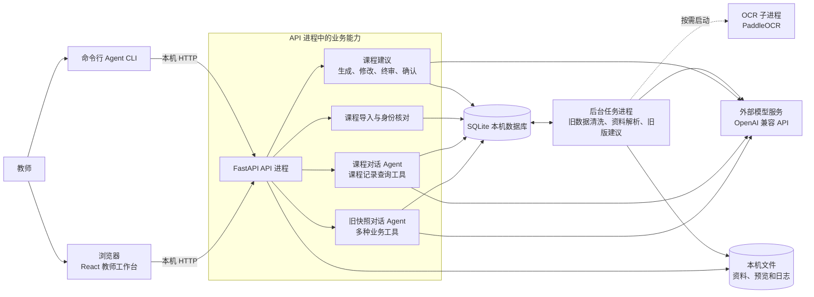

# 智慧学伴 1.0 架构大纲

本文描述 2026-11-27 工作区的 1.0 基线，用于说明当前实现及边界，不代表已发布或完成真实教师验收。操作命令和功能说明见 [README.md](README.md)，后续任务和交接见 [HANDOFF.md](HANDOFF.md)。

## 目标与使用方式

智慧学伴是面向不同课程教师的 Windows 本机工作台。教师可导入学情表格、核对学生身份、查看课程成绩与评价、上传教学资料、使用学情对话，并审核学习建议。学科和年级不应默认限定；当前实现仍有旧赛题数据和数学专用变式能力，跨课程功能需继续验收。

应用通过浏览器访问本机 FastAPI 服务，也可通过 `scripts/agent_cli.py` 调用同一组业务 API。教师在涉及数据确认、资料发布和建议确认的步骤参与核对。模型使用 OpenAI 兼容接口，密钥从本机凭据库或既有环境配置读取。

## 应用与实例图

图中为逻辑关系。常规 `start.ps1` 启动一个 API 进程和一个后台任务进程；OCR 在需要时作为独立子进程运行。课程建议生成和终审目前在 API 请求中直接调用模型，旧数据清洗、资料解析和旧版建议由后台进程执行。

## 数据与主要流程

- **旧快照路径**：从既有五类业务表清洗和确认快照；提供指标画像、原始作答、资料检索、建议、任务和部分正式导出。指标统计与相关历史功能依赖原有数据结构。
- **课程数据路径**：按课程、班级和学生管理成绩与教师评价，支持 CSV 和多工作表 XLSX、横向题目列、可选满分、身份核对、导入预览及批次回收恢复。原始文件及映射保存在 SQLite；课程记录、建议与旧快照使用同一数据库中的不同结构。
- **课程对话与建议**：课程对话 Agent 当前只有 `read_course_records` 工具，可按班级和活动读取当前课程记录；选择学生时限定该学生。查询最多返回 50 条并标记截断。课程建议在画像页面生成、修改、终审和教师确认，生成最多使用 100 条记录；确认时校验数据版本。
- **教学资料**：文档解析优先使用文字层，扫描页和图片按配置使用 OCR；资料需教师校对发布。旧快照 Agent 可检索已发布资料，课程 Agent 当前没有资料检索工具。
- **持久化**：SQLite 位于 `var/`，其中既有通用 `records` 存储，也有课程关系表、查询索引和全文检索索引。上传资料、预览、日志及部分衍生文件位于 `var/`；课程导入原件另作为批次数据存于 SQLite。`var/`、赛题原件、虚拟环境和密钥文件不进入 Git。

## 当前边界

- 这是单机工作台，课程数据支持课程隔离，但尚无多教师登录与权限系统。
- 新课程 Agent 尚不能直接调用课程导入、建议审核、课程批次管理或旧资料检索工具；相应部分能力已存在于页面或 API。
- 课程记录尚无可核验的活动日期，不能可靠推断历次进步或退步。题目内容和课程指标关联也有待扩展。
- 模型给出的分析和终审需要教师判断；当前课程 Agent 的模型回答没有旧路径同等的引用校验能力。
- 已有合成数据、真实模型及隔离浏览器的功能验证；尚未完成不同课程的真实教师教学质量验收。

## 关键位置

- `backend/main.py`、`backend/jobs.py`：API 入口和后台任务。
- `backend/course_data.py`、`backend/course_agent.py`、`backend/course_advice.py`：课程数据、课程 Agent 和课程建议。
- `backend/chat_agent.py`、`backend/snapshots.py`、`backend/student_query.py`：旧快照 Agent、快照和查询。
- `backend/materials.py`、`backend/search.py`、`ocr_worker/`：资料解析、检索与 OCR。
- `frontend/src/main.tsx`、`LearningChat.tsx`、`CourseImport.tsx`、`CourseProfile.tsx`：主要教师界面。
